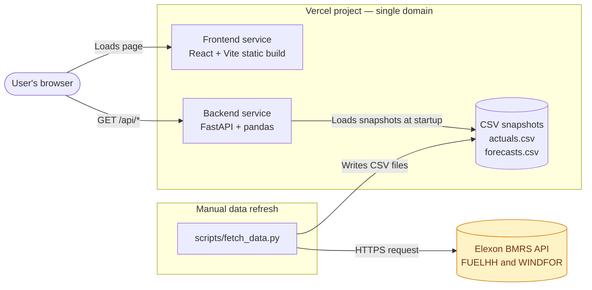
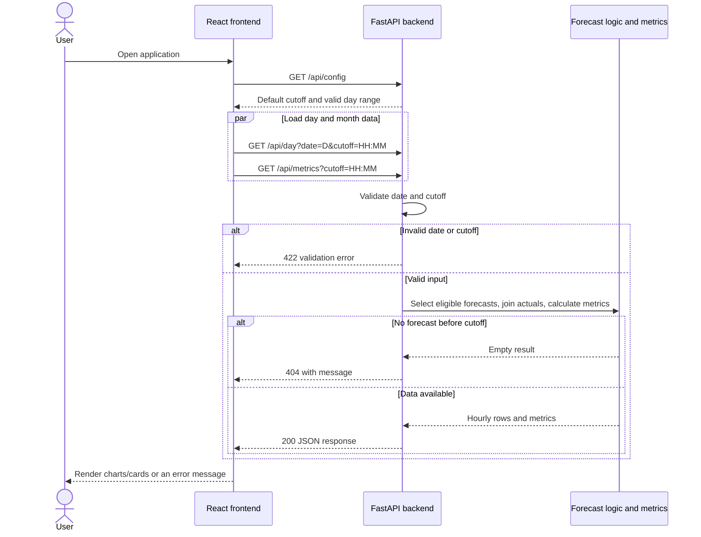

Wind Forecast Decision Support
Which wind forecast was available when the day-ahead decision had to be made, and how wrong is it likely to be?
A decision-support web app for the day-ahead power buying team of a UK energy utility. It selects the latest national wind forecast published before the decision cutoff, compares it with actual generation, and quantifies the error so purchase decisions can account for it.

Live App

Table of Contents
- Problem and Scope
- Key Findings
- Screenshots
- Tech Stack
- System Architecture
- How It Works
- Features
- Repository Structure
- Getting Started
- Configuration
- API Reference
- Core Logic and Metrics
- Testing
- Deployment
- Assumptions and Limitations
- Possible Improvements
- AI Tools Used
Problem and Scope
The utility buys electricity on the UK day-ahead market one day before delivery. Wind output depends on weather, so the amount of power that must be bought from other sources (for example, thermal plants) depends on wind forecasts.

This app helps the buying team:
1. See the latest wind forecast that was available when the decision had to be made.
2. Evaluate forecast accuracy quantitatively by comparing forecasts with actual generation.
Data scope: Elexon BMRS only, at national level.
- Actual generation: FUELHH API, filtered to fuelType = WIND, using startTime and generation.
- Forecast generation: WINDFOR API, using startTime, publishTime, and generation.
- Decision period: January 2026 decisions, made on D-1, covering delivery days 2 January 2026 to 1 February 2026 (31 days, 744 hours).
Key Findings
Computed from the January 2026 snapshot using the default 09:20 cutoff (/api/metrics).
Metric	Value
Hours evaluated	744
Bias (forecast − actual)	+1,748 MW
Mean Absolute Error (MAE)	2,039 MW (18.1% of mean actual)
Root Mean Squared Error (RMSE)	2,505 MW
Median absolute error	1,671 MW
P90 absolute error	4,098 MW
P95 absolute error	5,283 MW

- The forecast was above actual generation on average. On several days (including 11, 12, and 28 January), it was above actual in every hour.
- For a buyer, relying on the forecast alone could overestimate wind availability and lead to buying too little electricity from other sources.
- The cause of the bias was not investigated. These figures describe the same month used to calculate them, so they are indicative rather than a guarantee of future accuracy.
Screenshots
Place genuine screenshots under docs/screenshots/ using these filenames:
File	What it shows
docs/screenshots/decision-day.png	Decision day tab, decision-basis banner, forecast vs actual
docs/screenshots/month-overview.png	Month overview and overall accuracy cards
docs/screenshots/month-charts.png	Daily MAE and bias, plus error by hour of day

If these image files are not present in the repository yet, add the actual screenshots before relying on these previews.

Tech Stack

Frontend

Backend and Data Processing

Containers, Web Server, and Hosting

Testing

Area	Technologies / Purpose
Frontend	React, Vite, Recharts
Backend	Python, FastAPI, pandas, Uvicorn
Data source	Elexon BMRS API (FUELHH, WINDFOR); stored locally as CSV snapshots
Containers and web server	Docker, nginx
Hosting	Vercel
Testing	pytest

There is no database, authentication, or external AI service in this project.
System Architecture

The browser loads the static React application and then calls /api/* on the same domain. Vercel routes /api/* to the FastAPI service and other requests to the frontend.

The backend loads two CSV snapshots into memory when it starts. It does not call Elexon at runtime. The scripts/fetch_data.py script is run manually to refresh the snapshots.

With Docker Compose, nginx serves the built frontend and proxies /api/ requests to the backend container.
How It Works
1. The frontend requests GET /api/config to retrieve the default cutoff and valid delivery-day range.
2. It selects the first valid delivery day and default cutoff, then requests GET /api/day and GET /api/metrics.
3. The backend validates the date and HH:MM cutoff.
4. It converts the D-1 cutoff in UK local time to UTC.
5. For each delivery hour, it selects the latest forecast whose publishTime is at or before the cutoff.
6. It averages the two half-hourly actual readings into an hourly value, dropping incomplete hours.
7. It joins forecast and actual data, calculates errors and metrics, and returns JSON.
8. React renders the decision-basis banner, charts, and metric cards. Changing the date or cutoff repeats the relevant requests and calculations.

Features
- Decision-basis banner: Shows the cutoff in UK time and UTC, plus the publication time of the latest forecast used.
- Configurable cutoff and delivery day: Select a cutoff time and delivery day between 2 January and 1 February 2026.
- Forecast vs actual chart: Compare hourly forecast and actual generation.
- Hourly error chart: Inspect the difference between forecast and actual.
- Daily accuracy cards: View bias, MAE, RMSE, and P90 absolute error for a selected day.
- Monthly overview: View bias, MAE, RMSE, median, P90, and P95 absolute error across all 744 hours.
- Daily and hourly analysis: Explore daily MAE and bias, plus error patterns by hour of day.
- Decision-support note: Shows monthly bias and P90 error alongside the selected day.
- Loading and error states: Handles invalid input and missing forecasts.
- Unit tests: Covers forecast cutoff selection, hourly averaging, and metric calculations.
Not implemented: demand or electricity-price data, forecasting models, authentication, persistent database storage, and automated data refresh.
Repository Structure
.
├── backend/
│   ├── app/
│   │   ├── __init__.py
│   │   ├── config.py
│   │   ├── forecast_logic.py
│   │   ├── metrics.py
│   │   └── main.py
│   ├── data/
│   │   ├── actuals.csv
│   │   └── forecasts.csv
│   ├── tests/
│   │   └── test_logic.py
│   ├── Dockerfile
│   ├── .dockerignore
│   ├── requirements.txt
│   └── requirements-dev.txt
├── frontend/
│   ├── src/
│   │   ├── main.jsx
│   │   ├── App.jsx
│   │   ├── DayView.jsx
│   │   ├── MonthView.jsx
│   │   ├── api.js
│   │   ├── ui.jsx
│   │   └── styles.css
│   ├── index.html
│   ├── vite.config.js
│   ├── nginx.conf
│   ├── Dockerfile
│   ├── .dockerignore
│   ├── package.json
│   └── package-lock.json
├── scripts/
│   ├── fetch_data.py
│   ├── probe_elexon.py
│   └── probe2.py
├── docs/
│   └── screenshots/
├── docker-compose.yml
├── vercel.json
├── README.md
└── .gitignore
- backend/app/: API, configuration, forecast selection, and metrics.
- backend/data/: CSV snapshots of actual generation and forecasts.
- backend/tests/: backend unit tests.
- frontend/src/: React entry point, views, API client, UI helpers, and styling.
- scripts/: data retrieval and Elexon data inspection scripts.
- docs/screenshots/: README screenshots.
- docker-compose.yml: local multi-container setup.
- vercel.json: Vercel deployment and routing configuration.
Getting Started
The project was developed and tested with Python 3.14.7, Node.js 24.21.0, and Docker 29.8.0 on Windows.
Option 1: Docker
From the repository root:
docker compose up --build
Open http://localhost:8080.

Check the API health endpoint:
curl http://localhost:8080/api/health
Option 2: Run Without Docker
1. Start the backend
From the backend/ directory:
python -m venv .venv
Activate the virtual environment.

Windows PowerShell:
.venv\Scripts\Activate.ps1
macOS/Linux:
source .venv/bin/activate
Install dependencies and start FastAPI:
pip install -r requirements.txt
python -m uvicorn app.main:app --reload
The API runs at http://127.0.0.1:8000. Interactive API documentation is available at http://127.0.0.1:8000/docs.
2. Start the frontend
In a second terminal, from frontend/:
npm install
npm run dev
Open http://localhost:5173. The Vite development server proxies /api requests to http://127.0.0.1:8000, so the backend must be running.
Refresh the Data Snapshot
From the repository root, with the required Python dependencies available:
python scripts/fetch_data.py
This script fetches Elexon BMRS data and rewrites backend/data/actuals.csv and backend/data/forecasts.csv. Restart or redeploy the backend after refreshing the snapshots so the updated data is loaded.
Configuration
No API keys or secrets are required for the current Elexon data-fetching workflow.
Variable	Location	Default	Purpose
DEFAULT_CUTOFF	Backend	09:20	Default D-1 decision cutoff in UK local time (HH:MM)
DATA_DIR	Backend	backend/data	Directory containing the CSV snapshots
VITE_API_BASE	Frontend, build time	Empty (same origin)	API base URL when the API is hosted on a different domain

The .env file is listed in .gitignore.
API Reference
All endpoints use GET and require no authentication. Interactive documentation is available at /docs when the backend is running directly.
Endpoint	Purpose	Possible errors
/api/health	API status and loaded row counts	—
/api/config	Default cutoff, market timezone, and valid delivery-day range	—
/api/day?date=YYYY-MM-DD&cutoff=HH:MM	Hourly forecast vs actual data and daily metrics	422 invalid date/cutoff; 404 no forecast before cutoff
/api/metrics?cutoff=HH:MM	Overall metrics, daily MAE/bias, and metrics by hour	422 invalid cutoff; 404 no data

The cutoff parameter is optional and defaults to DEFAULT_CUTOFF.
Example: Health Check
{
  "status": "ok",
  "actual_rows": 1488,
  "forecast_rows": 19272
}
Example: Day Endpoint
Request:
GET /api/day?date=2026-01-15
Abbreviated response:
{
  "delivery_day": "2026-01-15",
  "cutoff_utc": "2026-01-14T09:20:00Z",
  "cutoff_local": "09:20",
  "latest_forecast_published": "2026-01-14T07:30:00Z",
  "hours": [
    {
      "time": "2026-01-15T00:00:00Z",
      "forecast_mw": 15834.0,
      "actual_mw": 14456.5,
      "error_mw": 1377.5,
      "forecast_published": "2026-01-14T07:30:00Z",
      "lead_hours": 16.5
    }
  ],
  "metrics": {
    "n_hours": 24,
    "bias_mw": 1041.83,
    "mae_mw": 1041.83,
    "rmse_mw": 1149.26,
    "p50_abs_error_mw": 1189.25,
    "p90_abs_error_mw": 1614.75,
    "p95_abs_error_mw": 1665.8,
    "mean_actual_mw": 10567.75,
    "mae_pct_of_mean_actual": 9.86
  }
}
Core Logic and Metrics
Forecast Selection — No Look-Ahead
For delivery day D, the cutoff is D-1 at the selected UK local time, converted to UTC using Europe/London. For every delivery hour, the application selects the latest forecast whose publishTime is less than or equal to the cutoff.

Forecasts published after the decision cutoff are excluded because they were not available at decision time. A forecast published exactly at the cutoff is eligible.
Aligning Data Resolution
WINDFOR provides hourly forecasts, while FUELHH provides half-hourly actual generation. Each actual hourly value is calculated as the mean of its two half-hourly readings. Hours missing either half-hour are dropped.
Error Metrics
Error is defined as:

Error = Forecast − Actual
- Positive error means forecast generation was higher than actual generation.
- Bias: Mean signed error.
- MAE: Mean absolute error.
- RMSE: Root mean squared error, which gives more weight to larger misses.
- P50/P90/P95: Percentiles of absolute error.
- MAE as a percentage of mean actual: MAE divided by mean actual generation.
MAPE is not used because wind generation can approach zero, making percentage errors unstable.
Data Handling
The CSV snapshots are loaded into memory when the backend starts. The January snapshot contains 1,488 half-hourly actual rows and 19,272 forecast rows from 264 publication times. Timestamps are stored in UTC; in January, UK local time is also UTC.
Testing
From the backend/ directory:
pip install -r requirements-dev.txt
python -m pytest -v
The project includes eight unit tests covering:
- Excluding forecasts published after the cutoff.
- Including forecasts published exactly at the cutoff.
- Handling cases where no forecast exists before the cutoff.
- Correct D-1 cutoff handling.
- Rejecting invalid cutoff input.
- Averaging half-hourly actuals and dropping incomplete hours.
- Metric calculations for known inputs.
- Empty input handling.
The recorded development result was 8 tests passed on Python 3.14.7 with pytest 9.1.1. There are no frontend or API-level automated tests.
Deployment
The application is deployed on Vercel as one project with two services, configured through vercel.json:
- Backend: FastAPI, rooted at backend/.
- Frontend: Vite, rooted at frontend/.
A top-level rewrite routes /api/* to the backend and other requests to the frontend. Both use the same domain, so no separate CORS or VITE_API_BASE configuration is needed for this deployment.

Live application: https://xk7qmv.vercel.app

The deployment's health endpoint was verified to return:
{
  "status": "ok",
  "actual_rows": 1488,
  "forecast_rows": 19272
}
To redeploy, push changes to the configured main branch and allow Vercel to build the repository.
Assumptions and Limitations
- The default 09:20 UK cutoff is an assumption about the day-ahead decision deadline, not a value supplied by the original brief. It is configurable and should be replaced with the client's actual deadline.
- Averaging two half-hours into one hour is a design decision.
- The cause of the observed positive bias has not been investigated. The datasets may define wind generation differently.
- Metrics are calculated on the same month they describe, so they are indicative rather than a guarantee of future accuracy.
- The scope covers wind generation and January 2026 decisions only.
- The app does not include demand data, electricity prices, or a forecasting model.
- The data is a fixed snapshot. New Elexon data is not reflected until the snapshot is refreshed and the application is redeployed.
- Some WINDFOR publication times fall outside the regular schedule; these were not otherwise analysed.
Possible Improvements
These are suggestions, not implemented features:
- Evaluate accuracy out of sample by learning bias on earlier days and testing on later days.
- Analyse accuracy by forecast lead time and wind output level.
- Investigate the source of the systematic forecast bias.
- Schedule automatic data refreshes.
- Add frontend and API-level tests.
